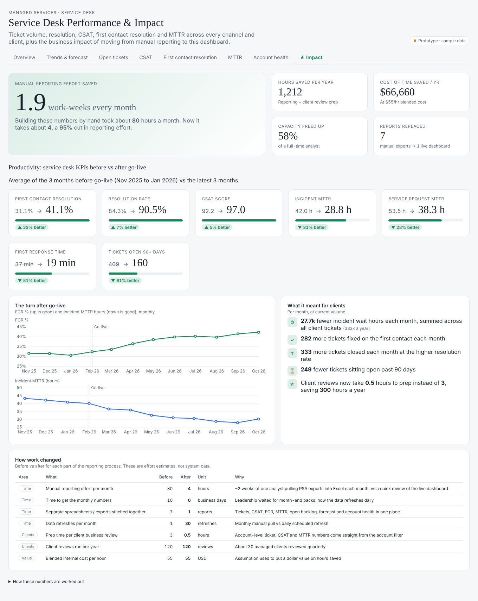
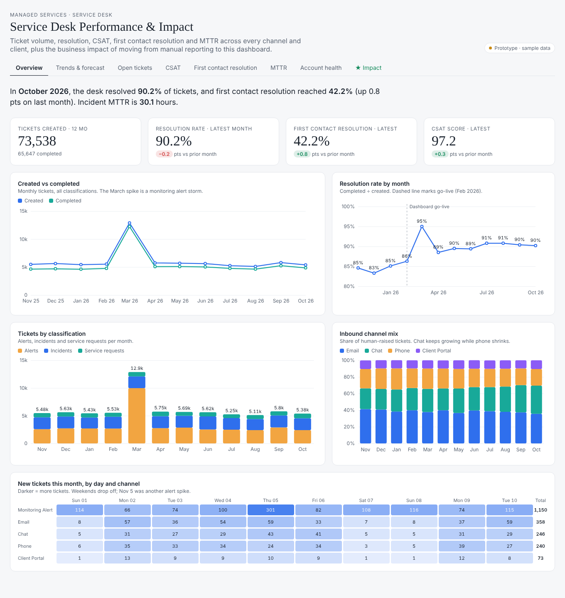
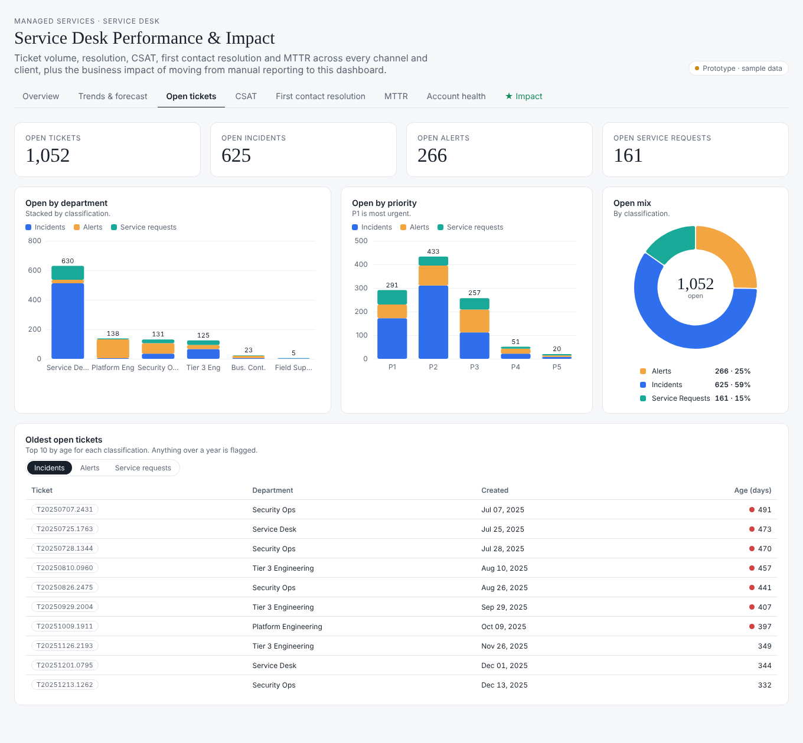
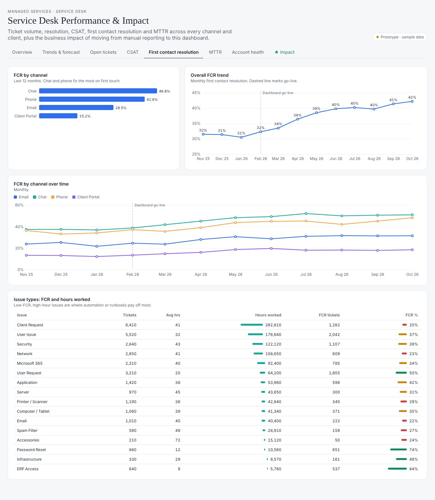
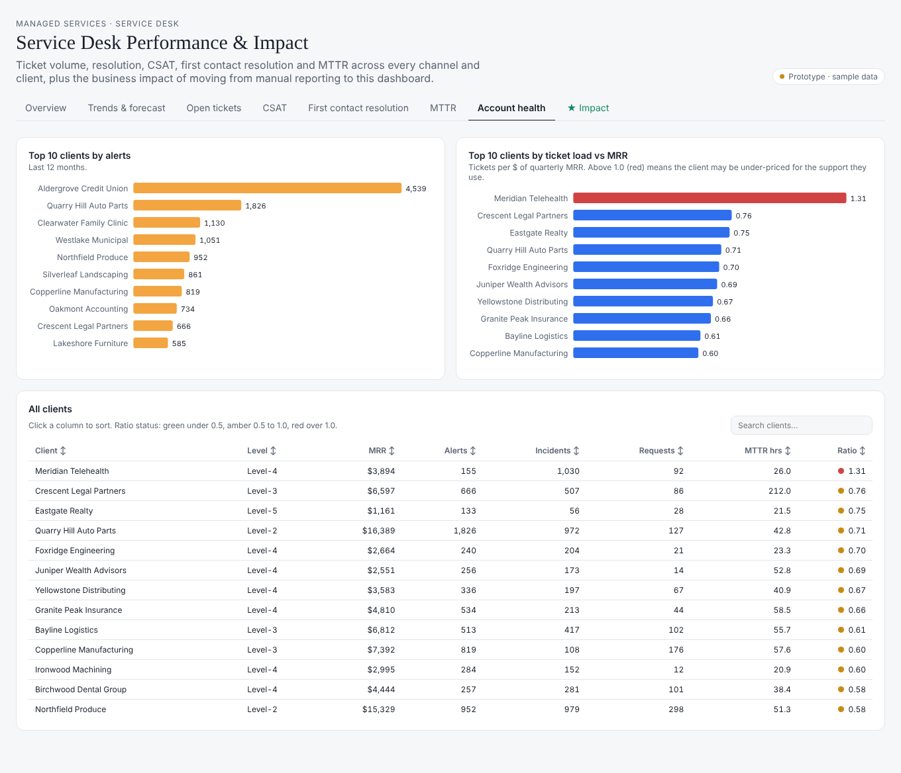

# Service Desk Performance & Impact Dashboard

An interactive prototype of a service desk analytics dashboard for a managed service provider (MSP). It covers ticket volume, resolution, first contact resolution (FCR), CSAT, MTTR, open backlog and client account health. It also has an **Impact** page showing what changed after moving from manual reporting to a live dashboard.

> **All data in this repo is synthetic.** Client names, ticket IDs and every number are generated by `scripts/generate_sample_data.py`. This is a portfolio rebuild of a production Power BI report, made safe to share publicly.



## Pages

| Page | What it answers |
|---|---|
| **Overview** | How many tickets came in, how many we closed, how resolution, FCR and CSAT are trending, and which channels clients use |
| **Trends & forecast** | Month-to-date vs forecast by severity, channel and classification, weekday load, last 15 days |
| **Open tickets** | Open backlog by department, priority and classification, and the oldest open tickets |
| **CSAT** | Score by channel against a 95 target, trend, survey response rate, CSAT by client |
| **First contact resolution** | FCR by channel and over time, plus which issue types eat the most hours with the lowest FCR |
| **MTTR** | Resolution time by severity and channel, trend, and the clients with the slowest resolution |
| **Account health** | Alerts and tickets per client against MRR, to flag clients who may be under-priced for the support they use |
| **★ Impact** | Time saved, productivity gains before vs after go-live, and the effect on clients |

## The impact story

The original report replaced about **two weeks of manual reporting every month**: pulling PSA exports, stitching 7 spreadsheets together and building month-end packs by hand.

The Impact page turns that into numbers:

- **Time:** reporting effort per month (80 → 4 hours), hours saved per year, dollar value at a blended hourly cost, and analyst capacity freed up
- **Productivity:** 3-month averages before vs after go-live for FCR, resolution rate, CSAT, incident and request MTTR, first response time and aged backlog
- **Clients:** incident wait hours avoided, extra first-contact fixes, extra tickets closed, aged tickets cleared and faster business review prep

The effort figures live in `data/impact_assumptions.csv`. Edit that file and the whole page recalculates.

## Screenshots

| Overview | Open tickets |
|---|---|
|  |  |

| First contact resolution | Account health |
|---|---|
|  |  |

## Run it locally

It's a static site with no build step:

```bash
python -m http.server 8000
# open http://localhost:8000
```

Or turn on GitHub Pages (Settings → Pages → deploy from `main`, root folder) to get a shareable link.

## Project structure

```
index.html                     page layout and styles
js/shim.js                     loads the CSVs and re-draws charts on data, tab and resize changes
js/lib.js                      chart helpers (line, bar, ranked bar, donut, rings, tables, tooltips)
js/calcs.js                    derived metrics: KPIs, channel share, before/after impact
js/pages.js                    charts and tables for the 7 operational pages
js/impact.js                   the Impact page
js/nav.js                      tabs, sorting, search and filters
js/vendor/d3.min.js            D3 v7
data/*.csv                     synthetic sample data
scripts/generate_sample_data.py  regenerates the sample data
```

## Original build

The production version was built in **Power BI** on top of PSA ticket data (Autotask) modeled in **Microsoft Fabric**, with DAX measures for FCR, MTTR, CSAT and forecasting. This repo recreates the design and logic in D3 so it can be shared without exposing any client data.

## Tech

D3.js v7 · vanilla JavaScript · CSS grid · Python (data generation)
